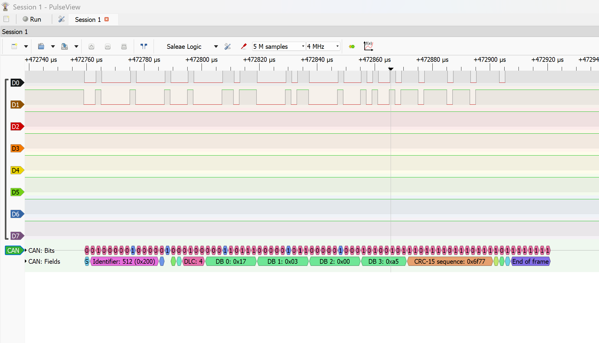
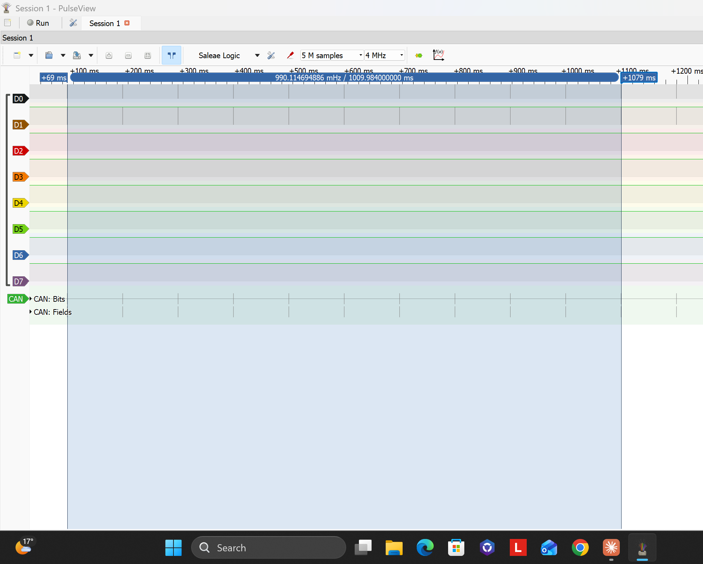

# Distributed Parking Assist System with CAN

Two-ECU parking assist system: a sensor node measures the distance to an obstacle and sends it
over a CAN bus at 500 kbit/s to an HMI node, which classifies it into warning zones and informs
the driver through an LCD message and an LED blink pattern.

## Status (work in progress)
- [x] Sensor node: CAN bring-up in loopback at 500 kbit/s, interrupt-driven receive, SWO debug output
- [x] Sensor node: ultrasonic distance measurement (HC-SR04, TIM2 PWM trigger and input capture)
- [x] CAN message `PA_Distance` (ID 0x200) with status and alive counter, specified in a DBC file
- [x] HMI node: CAN bring-up, receives and decodes `PA_Distance`
- [x] HMI node: own HD44780 driver for a 1602 LCD in 4-bit mode
- [x] Two-node bus over SN65HVD230 transceivers: live distance from the sensor node shown on the HMI's LCD
- [x] Bus diagnostics on the sensor node: CAN error status register shown on LEDs and debug console
- [x] HMI node: distance warning zones with LCD messages, LED blink patterns and CAN timeout detection
- [x] CAN timing verified with a logic analyser: bit time, frame length, cycle time and bus load
- [ ] Acoustic warning (buzzer) and hysteresis on the zone limits
- [ ] FreeRTOS application structure
- [ ] Diagnostics (UDS over ISO-TP) and bus-off recovery

## System overview
| Node | Board | MCU | Role |
|---|---|---|---|
| Sensor node | STM32F407G-DISC1 | STM32F407VG (168 MHz) | Measures distance, sends `PA_Distance` every 100 ms |
| HMI node | NUCLEO-F103RB | STM32F103RB (64 MHz) | Receives `PA_Distance`, evaluates warning zones, drives LCD and LED |

Using two different microcontroller families on one bus mirrors real vehicles, where ECUs come
from different suppliers.

## Warning zones (HMI node)
The HMI node classifies every received distance into a zone. Limits, LED patterns and LCD texts
are defined in tables in `hmi_node/Core/Src/main.c`, so changing a threshold is a one-line edit.

| Zone | Condition | LCD line 1 | LED LD2 |
|---|---|---|---|
| Clear | distance above 500 mm | `Path clear` | off |
| Caution | 301 to 500 mm | `Caution` | 100 ms on every 800 ms |
| Warning | 151 to 300 mm | `Warning: slow` | 100 ms on every 300 ms |
| Danger | 51 to 150 mm | `DANGER: brake!` | 60 ms on every 140 ms |
| Stop | 50 mm or less | `STOP!` | on |
| No echo | sensor status = 1 | `No echo/range` | off |
| Sensor lost | no `PA_Distance` frame for 300 ms | `Sensor lost!` | 50 ms on every 2 s |

LCD line 2 shows `Dist: xxxx mm`, or `Dist: -- mm` when no valid value is available.

Design notes:
- **Non-blocking main loop:** LED timing is derived from `HAL_GetTick()`, so the loop never waits
  in `HAL_Delay`. The LCD is refreshed every 100 ms, and the message line is rewritten only when
  the zone changes, which avoids flicker.
- **Message timeout:** the receive interrupt stores the time of the last valid frame. If the sensor
  node stops sending (wire break, power loss, bus fault), the HMI node reports `Sensor lost!`
  within 300 ms instead of showing a stale distance.
- **Output-independent logic:** the zone decision is separate from the output, so a buzzer can be
  added later with one additional pin write.

## CAN communication
The full message set is defined in [`can_parking_assist.dbc`](can_parking_assist.dbc).

**PA_Distance** (ID 0x200, 4 bytes, cycle 100 ms, sender: sensor node)
| Byte | Signal | Description |
|---|---|---|
| 0 to 1 | Distance | Distance in mm, unsigned 16-bit, little-endian |
| 2 | Status | 0 = valid, 1 = no echo or out of range |
| 3 | AliveCounter | Increments with every frame, lets the receiver detect a frozen sender |

**Bit timing (500 kbit/s on both nodes)**
| Node | CAN clock | Prescaler | Segment 1 | Segment 2 | Sample point |
|---|---|---|---|---|---|
| Sensor node | 42 MHz | 6 | 11 tq | 2 tq | 85.7 % |
| HMI node | 32 MHz | 4 | 13 tq | 2 tq | 87.5 % |

Both nodes run in normal mode with automatic retransmission enabled. Only the sensor node sends
`PA_Distance`; the HMI node only receives.

## Ultrasonic sensor (HC-SR04)
| Property | Value |
|---|---|
| Measuring range (datasheet) | 2 cm to 400 cm, most reliable about 5 cm to 2 m |
| Measuring angle (datasheet) | 15° |
| Frequency | 40 kHz |
| Trigger | 10 µs pulse every 60 ms (TIM2_CH3 PWM) |
| Echo evaluation | TIM2_CH2 input capture on both edges, 1 µs resolution |
| Valid range in firmware | echo up to 25 ms (about 4.3 m); otherwise `Status = 1` |
| Distance formula | mm = echo µs × 343 / 2000 (speed of sound at 20 °C) |

Flat, hard targets give the most stable readings. Surfaces tilted by more than about 15 to 20°
reflect the sound away, and soft materials absorb it; both result in `Status = 1`.

## Hardware and wiring
A complete wiring reference with breadboard diagrams is available in
[`docs/wiring_reference.pdf`](docs/wiring_reference.pdf).

**Transceivers (one SN65HVD230 module per node, powered from 3.3 V)**
| Module pin | Sensor node (STM32F407) | HMI node (STM32F103) |
|---|---|---|
| 3.3V | 3V pin | 3V3 (CN6, socket 4) |
| GND | GND | GND |
| CAN TX | PD1 | PA12 (CN10 outer row, level with D13) |
| CAN RX | PD0 | PA11 (CN10 outer row, level with D12) |

CAN TX on the module goes to CAN TX on the MCU, and RX to RX; a CAN transceiver does not cross
them the way a UART connection does.

**Bus**
| Connection | Purpose |
|---|---|
| CANH to CANH, CANL to CANL, as a twisted pair | differential bus signal |
| GND of both boards connected | common reference for both transceivers |
| 120 Ω termination on each module | two terminations in parallel give 60 Ω between CANH and CANL |

The 5 V supplies of the two boards are never connected; each board is powered from its own USB port.

**Sensor node (STM32F407)**
| Signal | Pin | Function |
|---|---|---|
| CAN1 RX / TX | PD0 / PD1 | CAN (internal pull-up on RX) |
| Trigger | PA2 | TIM2_CH3, 10 µs pulse every 60 ms |
| Echo | PA1 | TIM2_CH2, input capture on both edges (via 1 kOhm / 2 kOhm divider from 5 V to 3.3 V) |
| Diagnostic LEDs | PD12, PD14, PD15 | green = bus OK, red = transmit errors, blue = no acknowledgement |
| Debug output | PB3 | SWO (printf via ITM) |

**HMI node (STM32F103)**
| Signal | Pin | Function |
|---|---|---|
| CAN RX / TX | PA11 / PA12 | CAN (internal pull-up on RX) |
| LCD RS, E | PA0, PA1 | 1602 LCD control (4-bit mode, RW tied to GND) |
| LCD D4 to D7 | PA4, PB0, PC1, PC0 | 1602 LCD data |
| Warning LED | PA5 (LD2) | blink pattern per warning zone |
| Debug output | PB3 | SWO (printf via ITM) |

LCD supply: 5 V from the Nucleo, contrast set with 1 kOhm from V0 to GND (no potentiometer needed),
backlight through 330 Ω.

## Software components
- **Distance measurement:** TIM2 runs at 1 µs per tick with a 60 ms period. Channel 3 generates the
  trigger pulse in hardware; channel 2 captures both edges of the echo, and the pulse width gives
  the distance.
- **CAN message handling:** the sensor node packs distance, status and alive counter into
  `PA_Distance`; the HMI node checks ID and length in the receive interrupt, decodes the signals
  and records the reception time.
- **Warning logic:** `GetZone()` maps distance, status and message age to a zone;
  `WarningLed_Update()` produces the LED pattern from a lookup table.
- **LCD driver:** `hmi_node/Core/Src/lcd1602.c` implements the HD44780 initialisation sequence for
  4-bit mode, with microsecond timing from the Cortex-M3 cycle counter (DWT). API: `LCD_Init`,
  `LCD_Clear`, `LCD_SetCursor`, `LCD_Print`.
- **Bus diagnostics:** the sensor node reads the CAN error status register (ESR) after each frame
  and shows the transmit error counter (TEC) and last error code (LEC) on LEDs and in the console.

## Build and run
1. Open both projects in STM32CubeIDE (`sensor_node`, `hmi_node`); configuration changes are made in
   the standalone STM32CubeMX with the `.ioc` files.
2. With both boards connected, set the ST-LINK serial number in each project's debug configuration
   (Debugger tab, ST-LINK S/N), so each project always connects to its own board.
3. Flash the sensor node and let it run, then debug the HMI node. Enable Serial Wire Viewer
   (core clock 168 MHz for the sensor node, 64 MHz for the HMI node) and ITM port 0 to see the
   debug output.

## Test procedure (warning zones)
| Test | Expected result |
|---|---|
| HMI node powered, sensor node off | `Sensor lost!`, LD2 flashes every 2 s |
| Flat object moved from 60 cm to 3 cm | messages step from `Path clear` to `STOP!`, LD2 blinks faster until steady on |
| Sensor pointed into open space | `No echo/range`, LD2 off |
| Sensor node unplugged during operation | `Sensor lost!` within 0.3 s |

## Measurements (logic analyser)
The bus was checked with a 24 MHz 8-channel logic analyser (fx2lafw driver) in PulseView with the
CAN protocol decoder (500 kbit/s, sample point 87.5 %).

**Setup**
| Analyser channel | Connected to | Signal |
|---|---|---|
| D0 | PD0 (sensor node) | CAN RX: everything on the bus, as seen through the transceiver |
| D1 | PD1 (sensor node) | CAN TX: only what the sensor node itself sends |
| GND | GND (sensor node) | common reference |

Sample rate 4 MHz (8 samples per bit, 250 ns resolution), 5 M samples, which gives a 1.25 s capture
with 12 consecutive frames.

**Results**
| Quantity | Expected | Measured |
|---|---|---|
| Bit time | 2 µs (500 kbit/s) | 2 µs |
| Frame length (4 data bytes) | 76 bits + 5 stuff bits = 81 bits = 162 µs | approx. 160 µs |
| Cycle time | 100 ms | 101.0 ms (10 periods = 1009.98 ms between cursors) |
| Frame rate | 10 Hz | 9.9 Hz |
| Bus load | well below 30 % | approx. 0.16 % (0.162 ms / 101 ms) |
| Transceiver loop delay (TX to RX) | below 1 µs | 250 ns or less (one sample) |
| Error frames | none | none |

**Decoded frame (example)**
| Field | Value | Meaning |
|---|---|---|
| Identifier | 0x200 (512) | `PA_Distance` |
| DLC | 4 | 4 data bytes |
| DB0, DB1 | 0x17, 0x03 | Distance = 0x0317 = 791 mm (little-endian) |
| DB2 | 0x00 | Status = valid |
| DB3 | 0xA5 | AliveCounter = 165 |
| CRC-15 | 0x6F77 | decoded without CRC error |
| ACK slot | dominant on D0, recessive on D1 | the HMI node acknowledged the frame |

**Interpretation**
- The measured bit time matches the configured prescaler and time segments on both nodes, which
  confirms that the clock trees and bit timing are set up correctly. Every frame was acknowledged,
  the CRC was valid and no error frames occurred.
- The ACK proof comes from comparing both channels: in the ACK slot the sensor node transmits
  recessive (D1 high), but the bus is dominant (D0 low), so another node must have driven it.
- The cycle time is 101 ms instead of 100 ms because `HAL_Delay(100)` waits one extra tick to
  guarantee the minimum delay, plus the run time of the loop itself.
- The decoder marks the stuff bits that the CAN controller inserts after five equal bits. They
  explain why the frame is longer than the 76-bit minimum.
- At 0.16 % bus load the design has large headroom: roughly 300 more frames of this size per
  100 ms would still stay below 50 % load, leaving room for more sensor nodes and UDS diagnostics.

The raw capture is stored in [`docs/can_capture.sr`](docs/can_capture.sr) and can be opened in
PulseView.

## Repository structure
| Path | Content |
|---|---|
| `sensor_node/` | STM32CubeIDE project for the sensor node |
| `hmi_node/` | STM32CubeIDE project for the HMI node, including the LCD driver and warning logic |
| `can_parking_assist.dbc` | CAN message specification |
| `docs/wiring_reference.pdf` | wiring diagrams for sensor, LCD, transceivers and bus |
| `docs/can_frame_pulseview.png` | logic analyser screenshot of one decoded `PA_Distance` frame |
| `docs/can_period_pulseview.png` | logic analyser screenshot of the cycle time measurement |
| `docs/can_capture.sr` | raw logic analyser capture (PulseView / sigrok format) |

## Tools
STM32CubeMX, STM32CubeIDE, STM32 HAL, Git, digital multimeter, logic analyser with PulseView (sigrok)

## Debugging log
Problems met during development, how they were found, and how they were fixed.

### Tooling and setup
- **CubeMX project could not be opened inside the IDE:** the `.ioc` file was created with the
  standalone STM32CubeMX 6.18.1, while the IDE's built-in CubeMX was version 6.15.0. Fix: import the
  generated code as an existing project and do all configuration in the standalone CubeMX.
- **HMI project would not build (23 errors in CMSIS RTOS2 and NN files):** the first code generation
  had used the EWARM (IAR) toolchain setting, which copied extra CMSIS libraries into `Drivers`.
  Fix: set the toolchain to STM32CubeIDE, delete the `Drivers` folder, and regenerate with
  "copy only the necessary library files".
- **ST-LINK not detected on the Nucleo, then a firmware prompt:** after reconnecting, the IDE offered
  an ST-LINK firmware update, which was applied (V2J46M33).
- **"Multiple ST-LINKs detected":** with both boards connected, the IDE did not know which board to
  debug. Fix: ST-LINK serial number selected in each project's debug configuration.
- **SWO console stayed empty:** ITM stimulus port 0 was not enabled, and the trace must be started
  before the program runs. Fix: tick port 0 in the trace configuration, start the trace, then resume.
- **Reading registers in the debugger:** expressions such as `hcan.Instance->ESR` only show a value
  while the program is paused ("Target not available" otherwise), and only for the board of the
  active debug session.
- **Duplicated `USER CODE` markers:** pasting a code block twice left two `USER CODE BEGIN 3` and
  `USER CODE END 3` comments in `main.c`. It compiled, but CubeMX relies on these markers to keep
  user code when regenerating, so the duplicates were removed.

### Sensor node
- **LED did not blink after flashing:** the debugger halts at `main()` by default, so the program had
  not started yet. Fix: resume execution (F8) after the debug session starts.
- **HAL_CAN_Start timeout (error 0x20000) in loopback mode:** found by reading `hcan1.ErrorCode` in the
  debugger after the program stopped in `Error_Handler`. Cause: the CAN RX pin (PD0) was floating with
  no transceiver attached, so the controller could not detect an idle bus and stayed in
  initialisation mode. Fix: internal pull-up on PD0; applied to PA11 on the HMI node from the start.
- **Sensor reported "no echo" after rewiring:** the status signal (`st=1`) and the alive counter showed
  that the CAN path worked while the measurement failed. Cause: an interrupted ground rail on the
  breadboard. Fix: sensor ground connected directly to a GND pin of the board.

### HMI node
- **Compiler warning on `snprintf` truncation:** the distance value is now limited to 4 digits before
  formatting, so the LCD line always fits its 16 characters.
- **Display contrast without a potentiometer:** V0 connected through 1 kOhm to GND; leaving V0
  unconnected would give a blank display even with working code.
- **LCD without power after moving to a larger breadboard:** checked with a multimeter in DC voltage
  mode along the supply path (Nucleo 5V pin, + rail, LCD VDD, backlight anode) to find where the
  5 V stopped, and in continuity mode with power off to rule out a short between the rails.
- **No buzzer available:** the KY-037 module in the sensor kit is a microphone (sound detector), not
  a sound source. The warning output was therefore implemented on the on-board LED; the zone logic is
  independent of the output device, so a buzzer can be added later.

### Two-node bus
- **Simulated sender removed before going on the real bus:** in loopback mode the HMI node had sent
  itself a simulated `PA_Distance`. On a shared bus, two nodes sending the same ID with different
  data would collide, so the HMI node was changed to receive only before connecting the boards.
- **No communication on the real bus:** the HMI's LCD stayed at 0 and its receive LED never toggled.
  Diagnosis in steps:
  1. The sensor node's error status register showed an acknowledgement error (LEC = 3) with a rising
     transmit error counter: frames left the sensor node correctly, but no node acknowledged them.
     This ruled out the sensor node, its transceiver, and its PD0/PD1 wiring.
  2. The HMI node's error status register (`0x080009F9`) showed a receive error counter of 8 while
     its receive interrupt never fired: it saw activity on the bus but no valid frames. This pointed
     to the HMI's transceiver connection.
  3. Cause: the CAN RX/TX wires on the HMI node were on the wrong header pins. Fix: moved to PA11
     (level with D12) and PA12 (level with D13) on CN10. After that, the sensor node's green LED
     came on and the LCD showed the live distance.
- **Locating PA11/PA12 on the Nucleo:** they sit on the morpho header CN10 (outer row), not on the
  Arduino sockets. Counting CN10 from its first pin, which is above the SCL/D15 label, gives pins 12
  and 14; counting from the Arduino labels, they are level with D13 and D12. Mixing the two counting
  methods is an easy source of off-by-one wiring errors.

### Logic analyser
- **Analyser not recognised by PulseView:** the low-cost 24 MHz analyser needs the generic fx2lafw
  driver. Fix: WinUSB driver installed for the device with Zadig. The first installation hung
  because Windows had a restart pending; after restarting, the installation succeeded and PulseView
  detected the device.
- **Choosing the probe points:** both channels were placed on the sensor node's MCU side of the
  transceiver (PD0 and PD1) at 3.3 V logic level, not on CANH/CANL. The analyser only measures
  single-ended logic signals, and comparing TX with RX on one node shows both the transceiver delay
  and which node drives the ACK bit.
- **Capture long enough for the cycle time:** to measure the period, the capture must contain at
  least two frames 100 ms apart. 5 M samples at 4 MHz (1.25 s) captured 12 frames, and measuring
  across 10 periods instead of one averages out the jitter of the main loop.
